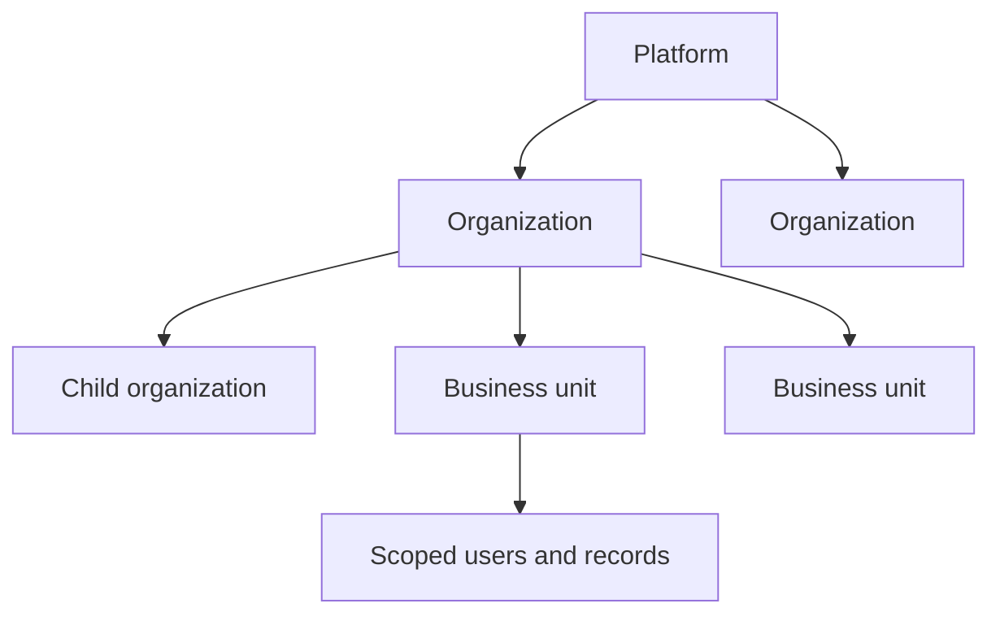

# Product guide

This guide explains the ERP in business language: who uses it, how records are separated, and how work moves between modules.

**Contents:** [Purpose](#purpose) · [Terms](#business-terms) · [Roles](#roles-and-responsibilities) · [Organization model](#organization-model) · [Modules](#module-overview) · [Journeys](#common-user-journeys) · [Examples](#how-modules-work-together)

**Related:** [README](../README.md) · [Architecture](02-architecture-and-codebase.md) · [Module reference](03-modules-apis-and-data.md) · [Handover](05-troubleshooting-and-handover.md)

## Purpose

Enterprise ERP puts customer, employee, delivery, and financial work in one system. A sales lead can become a deal and customer; delivery can be organized as projects and tasks; time and attendance can feed HR and payroll; quotes, invoices, payments, and ledger entries record the commercial result.

The system is multi-tenant. A **tenant** is an organization whose records are logically isolated from other organizations. Platform operators can manage organizations; ordinary users work only in organizations and business units they may access.

The web client has the broadest feature coverage. The mobile client provides selected day-to-day ERP workflows and is not a full mirror of every web administration screen.

## Business terms

| Term | Meaning in this system |
|---|---|
| Organization | The main tenant boundary: a company or related organizational node. Organizations can have a parent. |
| Business unit | A subdivision such as a region, department, or division. Users, employees, and operational records can be scoped to one. |
| Employee self-service (ESS) | Employee-facing attendance, leave, expense, payslip, and profile functions. |
| Lead / deal / customer | A potential buyer, a qualified sales opportunity, and a party that can receive project or billing work. |
| Workflow | A reusable approval process with stages, rules, assignments, actions, comments, and h istory. |
| Soft delete | Marking a record with `deletedAt` instead of immediately removing it from the database. |
| Audit log | A durable account of who changed a record, what changed, and where the request came from. |
| RBAC | Role-based access control: permissions are granted through roles rather than only page visibility. |

## Roles and responsibilities

The database enum defines seven base roles. Database-defined roles and permissions add finer access within organizations.

| Role | Typical responsibility | Important boundary |
|---|---|---|
| `SUPER_ADMIN` | Operates the platform, organizations, global reports, roles, and system settings | Platform operations are separate from tenant-visible audit data |
| `ADMIN` | Administers an organization, its users, business units, and operational modules | Limited to accessible organization scope |
| `HR` | Employees, shifts, attendance, leave, payroll, recruitment, and performance | HR access does not imply platform administration |
| `MANAGER` | Team, project, task, timesheet, leave, and expense review | Many views are restricted to managed people or assigned work |
| `EMPLOYEE` | Self-service, assigned projects/tasks, time, requests, and personal records | Primarily self-owned or assigned records |
| `COMPLIANCE_MANAGER` | Audit and compliance-oriented oversight | Exact effective rights depend on permission assignments |
| `CLIENT` | Approved client-portal projects | Project access is explicitly granted and can be revoked |

UI menus are convenience, not security. API guards and service-level scope checks are authoritative.

## Organization model

An organization is the tenant boundary used by most business models through `organizationId`. Organizations may form a parent/child hierarchy. Users can belong to an organization and access additional organizations. A selected organization supplies the current working context.

A business unit is a narrower boundary inside an organization. Users can switch among units they may access; unit administrators can be assigned. Employees and many business records carry a business-unit reference. Some legacy or global records have different scoping, so developers must use the shared scope services rather than adding ad hoc filters.

**Inferred rationale:** organization plus business-unit scope supports a hosted platform for several companies while also separating divisions inside a company. This follows from schema relationships, context middleware, scope services, and organization-switch APIs; no formal architecture decision record states the original reason.

## Module overview

| Area | What users do |
|---|---|
| Identity and administration | Sign in, manage profiles and sessions, select organizations and units, manage users, roles, permissions, settings, and audits |
| CRM and marketing | Capture campaign leads and leads, contacts, customers, activities, deals, campaigns, posts, forms, and events |
| Sales and finance | Manage products, quotes, public quote decisions, invoices, payments, ledger entries, and expenses |
| Projects and work | Plan projects, milestones, task lists, dependencies, issues, baselines, members, links, messages, tasks, checklists, watchers, timers, and timesheets |
| People operations | Manage employees, shifts, attendance sessions and breaks, holidays, leave, work-from-home-related attendance logic, payroll, payslips, recruitment, and performance |
| Service and shared tools | Tickets, files, imports/exports, notifications, activity timelines, approvals, dashboard, analytics, and reports |

“Implemented” means the repository contains an API and/or usable client flow. It does not guarantee equal client coverage, production configuration, or complete user-acceptance testing. Exact coverage is in the [module reference](03-modules-apis-and-data.md).

## Common user journeys

### From prospect to delivery and payment

1. Marketing or sales records a campaign lead or lead.
2. Sales assigns the lead, records activities, and converts a qualified lead into downstream CRM records.
3. A deal moves through its pipeline. Marking it won can trigger related workflow/event handling.
4. A quote is built from items, sent by email or public link, and accepted or rejected.
5. An accepted quote can become an itemized invoice.
6. Payments and ledger entries record settlement.
7. A customer can be linked to a project; explicitly invited client users can see granted projects.

### From work assignment to reviewed time

1. A manager creates a project, assigns managers and employees, and adds milestones or task lists.
2. Tasks are scheduled, assigned, discussed, watched, checked off, timed, and submitted for review.
3. Timesheets can link time to projects and tasks and move through review.
4. Project progress, workload, critical path, and baseline variance provide delivery views.

### From employee attendance to payroll

1. HR defines shifts, assignments, working days, and holidays.
2. Employees check in, take breaks, and check out. Fixed and flexible shifts are calculated differently.
3. HR reviews attendance, sessions, leave, compensatory-off claims, and exceptions.
4. Salary structures/templates and attendance metrics feed a payroll cycle.
5. Payroll entries produce payslips; employees view them through ESS.

Attendance and payroll contain date, timezone, concurrency, and approval rules. Treat the [module reference](03-modules-apis-and-data.md#people-operations) and tests as the contract before changing calculations.

## How modules work together

**Example: an agency engagement.** A lead from a campaign is assigned to a salesperson. Calls and meetings are stored as activities. After qualification, the lead becomes a deal and customer. Sales sends a quote; acceptance creates the basis for an invoice. Delivery creates a project, assigns a project manager and employees, and schedules tasks. Employees record time and task progress; the client sees only projects explicitly shared with their account. Payments close the financial loop, while notifications and audit history record important actions.

**Example: a leave request.** An employee submits leave through ESS. The service validates dates and balance rules, creates the request, and starts or advances approval work. A manager and HR can approve at their stages or reject. Notifications communicate the result. Approved leave influences attendance interpretation and payroll inputs. The shared workflow mechanism is described once in [architecture](02-architecture-and-codebase.md#shared-mechanisms).

## Product boundaries

- No checked-in evidence establishes statutory payroll compliance for every jurisdiction; configuration defaults include India-oriented PF, ESI, professional tax, and Form 16 concepts.
- Redis, queues, WebSockets, email, and object storage are conditional integrations, not automatic guarantees.
- Backup, point-in-time recovery, disaster recovery, and a tested rollback runbook are not defined in this repository.
- Billing and plan pages exist in the super-admin web area, but their operational completeness must be verified before treating them as a commercial subscription system.

[Next: Architecture and codebase →](02-architecture-and-codebase.md)
