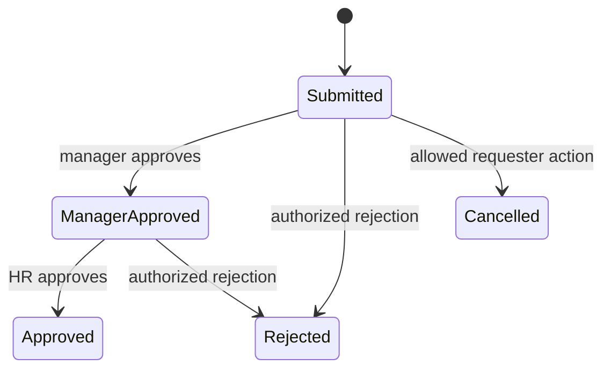

# Modules, APIs, and data

This is the compact implementation reference for every discovered application module. It maps business purpose to screens, API roots, and persisted data without duplicating the architecture guide.

**Contents:** [How to read](#how-to-read-this-reference) · [Platform](#platform-and-identity) · [CRM](#crm-marketing-and-sales) · [Delivery](#projects-work-and-service) · [People](#people-operations) · [Finance](#finance-and-commerce) · [Shared](#shared-platform-services) · [Data](#database-migrations-seeds-and-deletion) · [Integrations](#external-integrations)

**Related:** [Product guide](01-product-guide.md) · [Architecture](02-architecture-and-codebase.md) · [Development](04-development-testing-and-deployment.md) · [Handover](05-troubleshooting-and-handover.md)

## How to read this reference

API paths below are relative to `/api/v1` unless marked public. “Web” lists the principal route, not every add/edit/detail child. API controllers and development Swagger are the source for the full verb-by-verb contract. Access summaries are intentionally conservative: exact permission decorators, ownership checks, and organization/business-unit scope in each service control access.

Common failure cases across modules are unauthenticated requests (`401`), insufficient role/permission or ownership (`403`), missing or out-of-scope records (`404`), invalid DTOs or transitions (`400`), and uniqueness/concurrency conflicts (`409`).

## Platform and identity

| Module | Purpose and users | Web / API | Main data and rules |
|---|---|---|---|
| Authentication | All users sign in, refresh, sign out, reset/change passwords, and manage profile | `/login`, `/dashboard/profile`, `/super-admin/profile`; `auth/*` | `User`, `AuthSession`; bcrypt passwords, rotated refresh sessions, throttled login/reset, HttpOnly browser cookies |
| Users | Admins manage accounts, activation, roles, and reporting managers | `/dashboard/users`, `/super-admin/users`; `users` | `User`, `UserReportingManager`, `UserRole`; tenant and assignability checks apply |
| Organizations | Platform admins manage tenants; users select accessible context | `/select-organization`, `/dashboard/organization`, `/super-admin/organizations`; `organizations` | `Organization`; hierarchical parent, status lifecycle, logo, accessible/current organization |
| Business units | Admins organize and delegate subdivisions; users switch current unit | `/dashboard/business-units`, `/super-admin/business-units`; `me/business-units`, `organizations/:id/business-units`, `business-units/:id` | `BusinessUnit`, `BusinessUnitAdmin`; organization membership and unit-admin rules |
| RBAC | Platform/tenant administrators manage application roles and permissions | `/super-admin/roles`; `rbac/roles`, `rbac/permissions`, role-user/permission assignments | `AppRole`, `Permission`, `RolePermission`, `UserRole`; base enum roles still coexist |
| System settings | Platform operators manage global key/value configuration | `/super-admin/settings`; `system-settings` | `SystemSetting`; platform-only concern, not general tenant data |
| Client portal | Admins invite client accounts and grant project access; clients see granted work | client administration is under `/dashboard/clients`; `client-portal/users`, `client-portal/me/projects`, invitations | `ClientProfile`, `ClientProjectAccess`, `ClientInvitation`; invitations expire/are accepted; access can be revoked |

Authentication/bootstrap endpoints exist for controlled initialization. Do not expose them casually; production bootstrap is environment-gated and documented in the [development guide](04-development-testing-and-deployment.md#database-setup).

## CRM, marketing, and sales

| Module | Purpose and workflow | Web / API | Data, statuses, dependencies |
|---|---|---|---|
| Campaign leads | Import and qualify early marketing responses | `/dashboard/campaign-leads`; `campaign-leads` | `CampaignLead`; source/status fields, import, tenant scope |
| Leads | Capture, assign, update, and convert prospects | `/dashboard/leads`; `leads`, including `:id/owner`, `:id/convert`, `:id/detail` | `Lead`; owner reassignment activity; conversion metadata; relates to deals/contacts/activities/tasks |
| Contacts | Maintain people connected to sales work | `/dashboard/contacts`; `contacts` | `Contact`; status views/import; activities can attach to contacts |
| Customers | Maintain business or individual buying parties | `/dashboard/customers`; `customers` | `Customer`; `BUSINESS`/`INDIVIDUAL`, optional details and short name; projects can reference customers |
| Activities | Record calls, email, meetings, notes, and sales changes | embedded in CRM detail; `activities`, plus lead/deal/contact lists | `Activity`; typed timeline attached to CRM entities |
| Deals | Track opportunities through pipeline and mark wins | `/dashboard/deals`, `/dashboard/deals/pipeline`; `deals`, `deals/pipeline`, `:id/won`, owner change | `Deal`; status/stage and owner; won action emits workflow/event work, optionally queued |
| Marketing campaigns | Plan campaigns and channel activity | `/dashboard/marketing-campaigns`; `marketing-campaigns` | `MarketingCampaign`; channel/status configuration |
| Marketing posts | Store campaign content/posts | exposed through marketing API/client where used | `MarketingPost`; belongs to marketing workflow |
| Dynamic forms | Define field schemas for target modules | `/dashboard/dynamic-forms` and `/dashboard/forms/dynamic`; `dynamic-forms` | `DynamicForm`; target module and JSON-like field configuration |
| Form submissions | Receive and administer submitted form values | `/dashboard/form-submissions`, `/dashboard/forms`; `form-submissions` | `FormSubmission`; links submission payload/status to form context |
| Events | Create and categorize business events | `/dashboard/events`; `events` | `Event`; event type, import, CRUD |

Lead conversion and deal-won flows span several models. Use service methods rather than manually creating related rows, or activity/audit/ownership metadata may be missed.

## Projects, work, and service

| Module | Purpose and workflow | Web / API | Data, statuses, dependencies |
|---|---|---|---|
| Projects | Plan delivery, membership, schedule, progress, risk, collaboration, and client work | `/dashboard/projects`; `projects` plus co-managers, employees, workspace, progress, critical-path, workload, milestones, task-lists, dependencies, issues, baselines, links, messages | `Project`, `ProjectMember`, `ProjectMilestone`, `TaskList`, `TaskDependency`, `ProjectIssue`, `ProjectBaseline`, `ProjectLink`, `ProjectMessage`; customer, creator, managers, tags, dates and status |
| Tasks | Assign and schedule work, collaborate, time, submit, and review | `/dashboard/tasks`; `tasks` plus query/bulk, messages, checklist, watchers, timer, status, submit-work/review | `Task`, `TaskCrewAssignment`, `TaskMessage`, `TaskChecklistItem`, `TaskWatcher`, `TaskTimerSession`, `TaskTimerInterval`; hierarchy, scheduling, progress, project/CRM links |
| Timesheets | Record project/task time and submit it for review | `/dashboard/timesheets`; `timesheets` | `Timesheet`; source, project/task links, submit/review/return lifecycle |
| Tickets | Categorize and track internal/service requests | `/dashboard/tickets`; `tickets`, `ticket-types` | `Ticket`, `TicketType`; type/status/assignee rules |
| Dashboard | Provide role-appropriate overview metrics | `/dashboard`; `dashboard` | Aggregates other modules; no independent primary model |
| Analytics and reports | Aggregate operational and platform data | `/dashboard/reports`, `/super-admin/reports`; `analytics/summary`, `analytics/super-admin-summary`, `reports/*` | Read models/aggregates; role and organization filters are essential |

Project status transitions and task review rules are enforced in services, not only by select options. Task schedules, parent/child relationships, dependencies, timers, timesheets, attendance-derived task work, and project progress interact; change these together.

## People operations

| Module | Purpose and workflow | Web / API | Data, statuses, dependencies |
|---|---|---|---|
| Employees | Maintain employment, department/designation, managers, unit, shift, and lifecycle data | `/dashboard/employees`; `employees` including import, deleted, restore | `Employee`, reporting-manager links; soft delete/restore; optionally linked to `User` |
| Attendance | Define shifts/holidays, record fixed or flexible sessions and breaks, reconcile and report attendance | `/dashboard/attendance`, `/ess/attendance`; `attendance` with check-in/out, breaks, shifts, assignments, history, sessions, reports, automation | `Shift`, `EmployeeShiftAssignment`, `Attendance`, `AttendanceSession`, break models, `Holiday`, `AttendanceReconciliationJob`; statuses include present, absent, half-day, leave, holiday, weekly-off and planning states |
| Leave | Submit leave and compensatory-off claims; manager then HR review | `/dashboard/leave`, `/dashboard/requests`, `/ess/leave`; `leave-requests` | `LeaveRequest`, `LeavePolicy`, `LeaveBalanceEntry`, `LeaveCompOffClaim`; date/day-count, half-day, entitlement, balance and staged approval rules |
| ESS | Give employees a single API facade for own attendance, leave, payslips, expenses, and profile | `/ess/*`; both `ess/*` and `employee-self-service/*` controller aliases | Delegates to attendance, leave, payroll, expense, and employee data; must resolve the authenticated employee |
| Payroll | Configure salary templates/structures, cycles, entries, deductions, earnings, tax declarations, payslips and Form 16 | `/dashboard/payroll`, `/dashboard/payslips`, `/ess/payslips`; `payroll/*` | `SalaryTemplate` and components, `SalaryStructure` and components, `PayrollCycle`, `PayrollEntry`, `PayrollEarnings`, `PayrollDeduction`, `Payslip`, `TaxDeclaration`, `PayrollConfig`, `Form16`; organization-scoped cycle uniqueness |
| Recruitment (ATS) | Manage job openings, candidates, stages, interviews | `/dashboard` coverage is limited/embedded; `ats/jobs`, `ats/candidates`, `ats/interviews` | `JobOpening`, `Candidate`, `Interview`; candidate stage and interview status |
| Performance | Manage goal cycles, employee goals, and reviews | `/dashboard/performance`; `performance/*` | `GoalCycle`, `Goal`, `PerformanceReview`; review uniqueness per employee/cycle and draft/submission states |
| Expenses | Submit receipts and expenses; manager/HR review or reject | `/dashboard/expenses`, `/ess/expenses`; `expenses`, receipt, manager-approve, hr-approve, reject | `Expense`; employee/unit ownership, workflow state, file receipt, soft deletion |

### Attendance constraints

- Organization timezone, shift working days, weekly holidays, holiday ranges, overnight work, flexible sessions, breaks, and approved leave affect interpretation.
- Write versions and reconciliation jobs protect or repair concurrent/stateful changes; administrative reopening and session recovery are explicit actions.
- Vercel automation uses a secret-protected endpoint. Realtime or Redis does not replace scheduled reconciliation.
- `ATTENDANCE_FLEXIBLE_TASK_CUTOVER_DATE` changes how task work contributes around the configured cutover. Treat it as a data-migration boundary.

### Approval transitions

Leave and expense requests use staged approval. A representative flow is:

Exact stored strings and allowed edits differ by module and are checked by service code and DTOs. Do not introduce a generic transition solely from this explanatory diagram.

## Finance and commerce

| Module | Purpose and workflow | Web / API | Data, statuses, dependencies |
|---|---|---|---|
| Products/items | Maintain sellable items and categories | `/dashboard/items`; `products`, category endpoints | `Product`, `ProductCategory`; quote/invoice items reference commercial values |
| Quotes | Build itemized offers, send them, expose expiring public links, record decisions, convert accepted work | `/dashboard/quotes`, `/public/quotes/:token`; `quotes`, send/public-link/PDF/convert; public `public/quotes/:token` accept/reject | `Quote`, `QuoteItem`, `QuotePublicLink`, `QuoteStatusHistory`; totals, tax/withholding, unit/type and status history |
| Invoices | Create/import itemized invoices, generate PDF, send, update status | `/dashboard/invoices`; `invoices`, PDF/send/status views | `Invoice`, `InvoiceItem`; client email, amounts, dates and status; payments/ledger downstream |
| Payments | Record payment against invoices | `/dashboard/payments`; `payments`, `payments/invoice/:id` | `Payment`; invoice relationship and status/amount validation |
| Ledger | Record accounting entries | `/dashboard/ledger-entries`; `ledger-entries` | `LedgerEntry`; organization-scoped debit/credit/accounting data |

PDF output uses PDFKit and shared logo helpers. Email sending and storage are integrations; a generated document is not evidence that delivery succeeded—check delivery logs/errors.

## Shared platform services

| Module | Purpose | API / data |
|---|---|---|
| Notifications | In-app records, recipients, preferences, counts, read state, admin creation, optional live updates | `notifications`; `Notification`, `NotificationRecipient`, `NotificationPreference`, `NotificationTemplate`, `NotificationDeliveryLog` |
| Activity timeline | Cross-module entity events, comments, mentions, assignments, and optional live feed | `timeline`; `ActivityTimeline`, `ActivityTimelineComment` |
| Audit | Tenant mutation history and separate platform/unresolved events | `audit-logs`; `AuditLog`, `SystemAuditEvent`; system view is privileged |
| Files and attachments | Upload, list by entity, download/stream through module services, delete metadata/storage | `file-attachments`, file-management APIs; `File`, `FileAttachment`, `FileActivity` |
| Workflows | Define and run staged approvals | `workflows`; definition/stage/rule/instance/step/action/comment/assignment/history/notification models |
| Import/export | Shared CSV/spreadsheet ingestion and exports | module `import` routes and export endpoints; `ImportLog` |
| Mail/email | Provider-neutral transactional delivery and controlled diagnostics | `mail/test` and debug endpoint are restricted; delivery uses configured adapter |

## Database, migrations, seeds, and deletion

`api/prisma/schema.prisma` defines over 100 models/enums. Migrations in `api/prisma/migrations/` are ordered history and include a July 2026 rebaseline plus later incremental changes. Never edit an applied migration to change current behavior; add a migration and validate from a clean database when possible.

| Operation | Command | Behavior |
|---|---|---|
| Generate client | `npm run prisma:generate` | Regenerates Prisma types/client |
| Validate schema | `npm --prefix api run prisma:validate` | Static schema validation |
| Apply existing migrations | `npm run prisma:migrate` | Runs `prisma migrate deploy`; does not create a migration |
| Development seed | `npm --prefix api run seed` | Creates development-oriented reference/sample setup; inspect before using shared data |
| Production seed | `npm --prefix api run seed:production` | Environment-gated, idempotent bootstrap without destructive reset |
| Bootstrap | `npm --prefix api run db:bootstrap` | Controlled super-admin/reference bootstrap; inspect environment safeguards |

Deletion behavior is model-specific:

- Many business records use `deletedAt` and service-level soft deletion.
- Required child records often use Prisma `onDelete: Cascade`.
- Optional references commonly use `SetNull`.
- Some unique constraints remain active for soft-deleted rows.

Always read the exact relation and service before promising restore or hard-delete behavior. The employee module has an explicit deleted/restore flow; this does not imply every soft-deleted module has one.

## External integrations

| Integration | Business use | Configuration/constraint |
|---|---|---|
| PostgreSQL | All durable business and auth data; production throttle fallback | `DATABASE_URL`; test databases use explicit test variables |
| Redis / BullMQ | Optional auth counters and optional deal queue | `RATE_LIMIT_REDIS_URL`/`REDIS_URL`, `REDIS_ENABLED`, `REDIS_QUEUE_ENABLED`; persistent workers disabled on Vercel |
| Socket.IO | Notification/timeline live hints | `WEBSOCKET_ENABLED`; process-local, no Redis adapter |
| Email | Invitations, password reset, notifications, quotes/invoices and diagnostics | Provider-specific credentials; `EMAIL_PROVIDER`; failed email must not be confused with failed core transaction unless service makes it blocking |
| S3-compatible storage | Durable uploaded files | bucket, region, prefix, credentials; local storage is not serverless durable |
| Vercel cron | Attendance automation | `CRON_SECRET`; configured schedule and endpoint must remain aligned |
| Public quote links | Customer quote view/decision | Random token, expiry/revocation rules, public controller |

[← Architecture](02-architecture-and-codebase.md) · [Next: Development, testing, and deployment →](04-development-testing-and-deployment.md)
